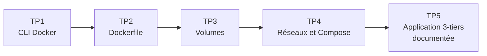
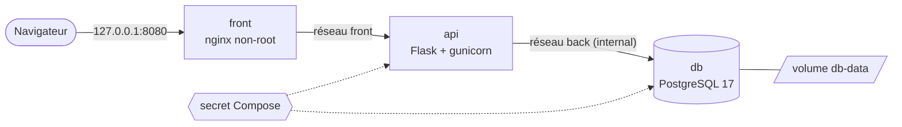

# Docker Labs — de la ligne de commande à une application 3-tiers sécurisée

Travaux pratiques Docker réalisés dans le cadre de la formation **Administrateur d'Infrastructures Sécurisées (AIS, Bac+3)**, en novembre 2026.

Le fil rouge est **TaskBoard**, une application de gestion de tâches composée d'une base PostgreSQL, d'une API Python (Flask) et d'un front nginx. Le code applicatif était fourni par la formation : l'objectif n'était pas de développer, mais de **conteneuriser, orchestrer, sécuriser et documenter**.

## Progression



| Lab | Thème | Ce qui a été mis en place | Documentation |
|---|---|---|---|
| TP1 | Premiers pas avec la CLI | Cycle de vie des conteneurs, inspection, limites de ressources, politiques de redémarrage, système de fichiers en lecture seule | [docs/tp1-cli.md](docs/tp1-cli.md) |
| TP2 | Conteneuriser l'API | Dockerfile optimisé pour le cache, utilisateur non-root, healthcheck sans curl, labels OCI, scan de vulnérabilités, registre privé | [docs/tp2-dockerfile.md](docs/tp2-dockerfile.md) |
| TP3 | Volumes | Persistance PostgreSQL, volume partagé en lecture seule, bind mount de configuration, sauvegarde et restauration | [docs/tp3-volumes.md](docs/tp3-volumes.md) |
| TP4 | Réseaux et Docker Compose | DNS interne, réseaux isolés, premier `compose.yaml`, healthchecks et ordre de démarrage | [docs/tp4-reseaux-compose.md](docs/tp4-reseaux-compose.md) |
| TP5 | Évaluation | Application 3-tiers complète : segmentation réseau, secret, durcissement, exploitation, procédure de déploiement | [taskboard/README.md](taskboard/README.md) |

## Le projet final : TaskBoard



Points clés de l'architecture :

- **Segmentation** : la base est sur un réseau interne, sans accès extérieur, joignable uniquement par l'API.
- **Exposition minimale** : un seul port publié, celui du front, et seulement sur `127.0.0.1`.
- **Secret** : le mot de passe de la base n'apparaît ni dans le code, ni dans le `compose.yaml`, ni dans les variables d'environnement.
- **Durcissement** : conteneurs non-root, système de fichiers en lecture seule, capacités Linux supprimées, `no-new-privileges`, limites CPU et mémoire.
- **Fiabilité** : healthchecks sur les trois services, démarrage ordonné `db` → `api` → `front`, redémarrage automatique, rotation des journaux.
- **Exploitation** : sauvegarde et restauration, mise à jour avec retour arrière, montée en charge de l'API (`--scale`).

### Déployer en 5 commandes

Sur une machine Linux avec Docker Engine 25 ou plus et le plugin Compose v2 :

```bash
git clone https://github.com/hedjouj/Docker.git docker-labs
cd docker-labs/taskboard
cp .env.example .env
mkdir -p secrets && chmod 700 secrets && openssl rand -base64 24 > secrets/db_password.txt && chmod 644 secrets/db_password.txt
docker compose up -d --build --wait
```

L'application répond ensuite sur `http://127.0.0.1:8080`. La procédure complète, avec les vérifications, l'exploitation et le dépannage, est dans [taskboard/README.md](taskboard/README.md).

## Environnement du lab

| Élément | Valeur |
|---|---|
| Hyperviseur | Proxmox VE (infrastructure de l'école), accès par VPN |
| Machine virtuelle | Debian 13 « Trixie », 2 vCPU, 4 Go de RAM, 10 Go de disque |
| Docker | Docker Engine et plugin Compose v2, installés depuis le dépôt officiel Docker |
| Images utilisées | `python:3.12-slim`, `nginxinc/nginx-unprivileged:1.27-alpine`, `postgres:17-alpine`, `nginx:1.27-alpine`, `alpine:3.20` |
| Outils | Trivy (scan de vulnérabilités), `registry:2` (registre local) |

## Compétences mobilisées

| Domaine | Compétences |
|---|---|
| Conteneurisation | Images, couches et cache de build, Dockerfile optimisé et sécurisé, registre |
| Stockage | Volumes nommés, bind mounts, montages en lecture seule, sauvegarde physique et logique |
| Réseau | Bridge personnalisé, DNS interne, réseaux `internal`, segmentation 3-tiers, reverse proxy |
| Orchestration | Docker Compose, variables et fichier `.env`, healthchecks, dépendances, scaling |
| Sécurité | Moindre privilège, non-root, `read_only`, `cap_drop`, `no-new-privileges`, secrets, scan de CVE |
| Exploitation | Journaux et rotation, limites de ressources, politiques de redémarrage, mise à jour et retour arrière |
| Documentation | Procédure de déploiement testable en Markdown, schémas Mermaid |

## Organisation du dépôt

```text
docker-labs/
├── README.md                    # cette page
├── docs/
│   ├── tp1-cli.md
│   ├── tp2-dockerfile.md
│   ├── tp3-volumes.md
│   └── tp4-reseaux-compose.md
└── taskboard/                   # projet final (TP5)
    ├── README.md                # procédure de déploiement et d'exploitation
    ├── compose.yaml
    ├── .env.example
    ├── db/
    ├── api/
    └── front/
```

## Auteur

**Elhadj Messaoui**, alternant technicien informatique, formation Administrateur d'Infrastructures Sécurisées.
