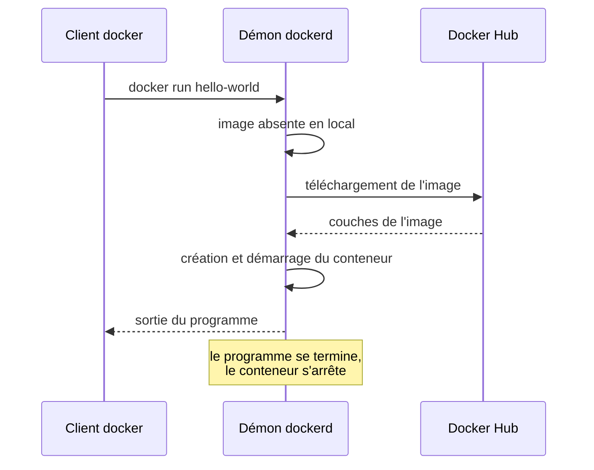

# TP1 — Premiers pas avec la CLI Docker

[← Retour à l'accueil](../README.md) · [TP2 →](tp2-dockerfile.md)

**Objectif** : piloter le cycle de vie d'un conteneur en ligne de commande et comprendre ce qu'est réellement un conteneur, puis appliquer les premières mesures d'exploitation et de sécurité (limites, redémarrage, lecture seule).

## 1. Installation et vérification

Docker Engine et le plugin Compose v2 sont installés depuis le dépôt officiel Docker sur une VM Debian 13 (procédure dans le [README de TaskBoard](../taskboard/README.md#3-prérequis)). L'utilisateur est ajouté au groupe `docker` pour lancer les commandes sans `sudo`.

```bash
docker version
docker run hello-world
docker info --format 'Driver={{.Driver}} Images={{.Images}}'
```

Ce qui se passe lors du `docker run hello-world` :



1. Le client `docker` transmet la demande au démon `dockerd` par le socket `/var/run/docker.sock`.
2. Le démon ne trouve pas l'image en local et la télécharge depuis le Docker Hub.
3. Il crée un conteneur à partir de l'image et exécute son programme.
4. La sortie du programme est renvoyée au client, puis le conteneur s'arrête.

**Pilote de stockage et nombre d'images** : `docker info`, lignes `Storage Driver` et `Images`.

## 2. Un serveur web nginx

```bash
docker run -d --name web -p 8080:80 nginx:1.27-alpine
curl -I http://localhost:8080
docker logs -f web
```

Chaque rafraîchissement de la page ajoute une ligne dans les journaux : nginx écrit ses logs sur la sortie standard, que Docker récupère.

Modification de la page d'accueil depuis l'intérieur du conteneur, puis suppression et recréation du conteneur :

```bash
docker exec web sh -c "echo '<h1>Hello AIS</h1>' > /usr/share/nginx/html/index.html"
curl -s http://localhost:8080
docker rm -f web
docker run -d --name web -p 8080:80 nginx:1.27-alpine
curl -s http://localhost:8080 | grep -i title
```

**La page modifiée a disparu.** La modification était écrite dans la couche inscriptible du conteneur, supprimée avec lui. Le nouveau conteneur repart de l'image, qui, elle, ne change jamais. Pour conserver des données, il faut un volume (voir [TP3](tp3-volumes.md)).

## 3. Inspecter un conteneur

```bash
docker inspect --format '{{range .NetworkSettings.Networks}}{{.IPAddress}}{{end}}' web
docker top web
ps -ef | grep [n]ginx
docker history nginx:1.27-alpine
```

**Les processus nginx apparaissent dans le `ps` de l'hôte**, avec d'autres numéros (PID) que dans le conteneur. Un conteneur n'est pas une machine virtuelle : c'est un simple processus de l'hôte, isolé par les *namespaces* (PID, réseau, système de fichiers…) et limité par les *cgroups*. Il partage le noyau de l'hôte.

## 4. Une base de données et la question des variables d'environnement

La base PostgreSQL reçoit son mot de passe et le nom de sa base depuis un fichier `db.env` :

```bash
cat > db.env <<'EOF'
POSTGRES_PASSWORD=Labo2026pwd
POSTGRES_DB=labo
EOF
docker run -d --name db --env-file db.env postgres:17-alpine
docker exec -it db psql -U postgres -d labo -c "CREATE TABLE test (id serial PRIMARY KEY, nom text);" -c '\dt'
```

Le mot de passe se retrouve pourtant sans ouvrir le fichier :

```bash
docker inspect --format '{{range .Config.Env}}{{println .}}{{end}}' db | grep PASSWORD
docker exec db env | grep PASSWORD
```

**Une variable d'environnement ne protège pas un secret.** Elle est lisible en clair par quiconque a accès à Docker (`docker inspect`, `docker exec env`, `/proc/<pid>/environ`), elle est transmise aux processus enfants et peut finir dans des journaux. Or l'accès au groupe `docker` équivaut à un accès administrateur sur l'hôte. La bonne pratique est de monter le secret en fichier, ce que fait le [projet final](../taskboard/README.md#8-sécurité) avec `POSTGRES_PASSWORD_FILE`.

## 5. Ressources, redémarrage et lecture seule

Relance de nginx avec des limites, une politique de redémarrage et une publication limitée à la machine locale :

```bash
docker rm -f web
docker run -d --name web --memory 128m --cpus 0.5 --restart unless-stopped -p 127.0.0.1:8080:80 nginx:1.27-alpine
docker stats --no-stream web
docker inspect --format 'Memory={{.HostConfig.Memory}} NanoCpus={{.HostConfig.NanoCpus}} Restart={{.HostConfig.RestartPolicy.Name}}' web
```

Résultat : `Memory=134217728` (128 Mio), `NanoCpus=500000000` (0,5 CPU), `Restart=unless-stopped`. Le port n'écoute plus que sur `127.0.0.1` : la page n'est plus joignable depuis le réseau, seulement depuis la VM.

**Comportement de la politique `unless-stopped`** :

```bash
# 1. Processus principal tué depuis l'hôte
sudo kill $(docker inspect --format '{{.State.Pid}}' web)
sleep 3
docker inspect --format 'Status={{.State.Status}} RestartCount={{.RestartCount}}' web

# 2. Arrêt volontaire, puis redémarrage du démon Docker
docker stop web
sudo systemctl restart docker
docker ps -a --filter name=web --format '{{.Names}} {{.Status}}'
```

| Situation | Comportement |
|---|---|
| Le processus est tué depuis l'hôte | Le conteneur redémarre seul, `RestartCount` augmente |
| `docker stop`, puis redémarrage du démon | Le conteneur reste arrêté : `unless-stopped` respecte un arrêt volontaire (avec `always`, il serait reparti) |

**Système de fichiers en lecture seule** :

```bash
docker run --rm --read-only alpine:3.20 touch /fichier
docker run --rm --read-only --tmpfs /tmp alpine:3.20 sh -c 'touch /tmp/fichier && ls -l /tmp'
```

La première commande échoue (`Read-only file system`). Avec `--tmpfs /tmp`, seul `/tmp` est modifiable, en mémoire, et il disparaît avec le conteneur. Le reste du système de fichiers est immuable : un attaquant ne peut pas y déposer d'outil. Cette protection est appliquée à l'API et au front du projet final.

## 6. Ménage

```bash
docker system df
docker container prune -f
docker image prune -f
```

`docker image prune` sans `-a` ne supprime que les images orphelines (`<none>`), jamais une image encore utilisée ou étiquetée.

## À retenir

- Un conteneur est un **processus isolé** de l'hôte, pas une VM.
- Tout ce qui est écrit dans un conteneur **disparaît avec lui**, sauf dans un volume.
- Les variables d'environnement **ne sont pas un endroit sûr** pour un mot de passe.
- `--memory`, `--cpus`, `--restart`, `-p 127.0.0.1:…` et `--read-only` sont les premières protections d'exploitation et de sécurité.
