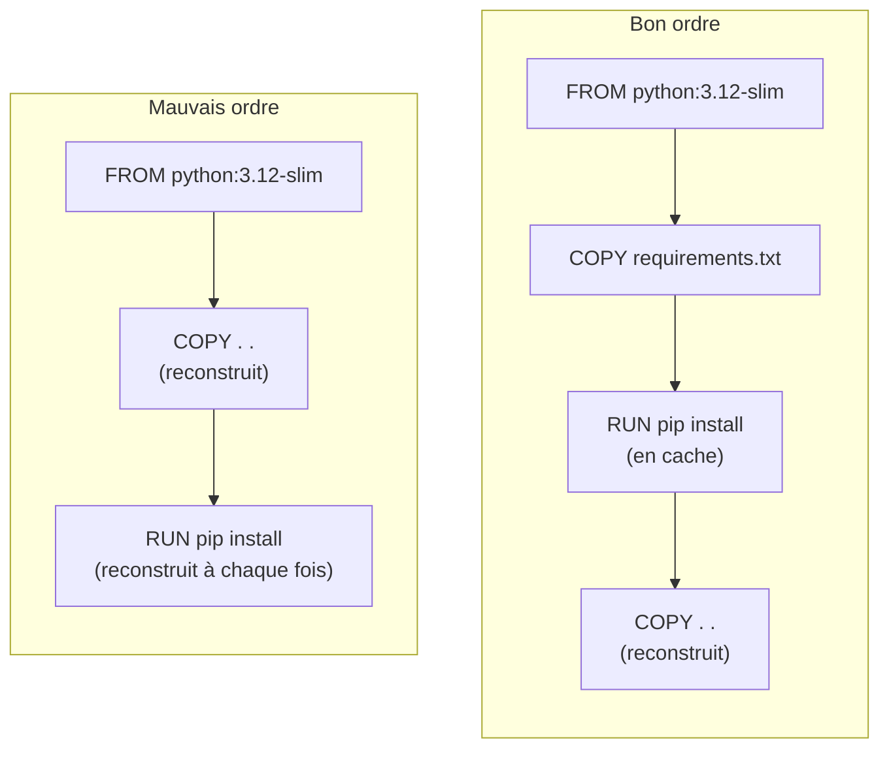

# TP2 — Conteneuriser l'API

[← TP1](tp1-cli.md) · [Retour à l'accueil](../README.md) · [TP3 →](tp3-volumes.md)

**Objectif** : transformer l'API Python de TaskBoard en image Docker propre, rapide à reconstruire, sécurisée et traçable.

L'API (Flask, servie par gunicorn) expose `/api/tasks` et `/api/health`. Son code est dans [taskboard/api](../taskboard/api).

## 1. Premier Dockerfile

```dockerfile
FROM python:3.12-slim
WORKDIR /app
COPY requirements.txt .
RUN pip install --no-cache-dir -r requirements.txt
COPY . .
EXPOSE 5000
CMD ["gunicorn", "-b", "0.0.0.0:5000", "app:app"]
```

| Choix | Raison |
|---|---|
| `python:3.12-slim` | Image de base minimale : moins de taille, moins de vulnérabilités |
| `requirements.txt` copié avant le code | Les dépendances restent en cache tant que la liste ne change pas |
| `--no-cache-dir` | Le cache de pip n'est pas conservé dans l'image |
| `CMD` en forme exec (tableau JSON) | gunicorn est le processus principal (PID 1) et reçoit directement le signal d'arrêt |

```bash
docker build -t taskboard-api:1.0 .
docker run -d --name api -p 5000:5000 taskboard-api:1.0
curl -i http://localhost:5000/api/health
```

**L'API répond `503`, et c'est normal.** gunicorn fonctionne, mais `/api/health` teste la connexion à la base. Or il n'y a ni base, ni variables de connexion (`KeyError: 'POSTGRES_DB'` dans `docker logs api`). Le healthcheck joue son rôle : il signale que le service n'est pas opérationnel de bout en bout.

## 2. Optimiser le cache de construction



Après une simple modification de `app.py` :

- **dans le bon ordre**, `FROM`, `WORKDIR`, `COPY requirements.txt` et `RUN pip install` sont marqués `CACHED`, seule la copie du code est refaite et la construction prend quelques secondes ;
- **dans le mauvais ordre** (`COPY . .` avant `pip install`), toute modification du code invalide la couche de copie et toutes celles qui suivent : les dépendances sont retéléchargées à chaque construction, nettement plus longue.

Un `.dockerignore` évite d'envoyer au moteur de construction des fichiers inutiles ou sensibles (`.git`, `.env`, `__pycache__`…) : [taskboard/api/.dockerignore](../taskboard/api/.dockerignore).

## 3. Sécuriser l'image

| Mesure | Mise en œuvre | Bénéfice |
|---|---|---|
| Utilisateur non-root | `appuser`, UID 10001, `USER 10001:10001` | Une faille dans l'application ne donne pas les droits root dans le conteneur |
| Code propriété de root | `COPY` sans `--chown` | L'application ne peut pas modifier son propre code |
| `PYTHONUNBUFFERED=1` | Variable d'environnement | Les journaux sortent immédiatement dans `docker logs` au lieu d'être retenus en mémoire, et ne sont pas perdus si le conteneur plante |
| `PYTHONDONTWRITEBYTECODE=1` | Variable d'environnement | Pas de fichiers `.pyc` écrits à l'exécution |
| Healthcheck sans curl | `python -c "import urllib.request; …"` | Python est déjà dans l'image : aucun outil supplémentaire, donc pas de surface d'attaque en plus |
| Label OCI de version | `ARG APP_VERSION` → `org.opencontainers.image.version` | Traçabilité : on sait quelle version tourne |

Vérifications :

```bash
docker build --build-arg APP_VERSION=1.1 -t taskboard-api:1.1 .
docker run -d --name api -p 5000:5000 taskboard-api:1.1
docker exec api id
docker image inspect --format '{{index .Config.Labels "org.opencontainers.image.version"}}' taskboard-api:1.1
```

Résultat : `uid=10001(appuser) gid=10001(appuser)` et la version `1.1`.

Le healthcheck s'appuie sur un comportement de Python : `urlopen` lève une exception sur un code d'erreur HTTP (comme `503`), le programme sort alors avec le code 1 et Docker marque le conteneur `unhealthy`.

### Améliorations apportées dans le projet final

Le [Dockerfile final](../taskboard/api/Dockerfile) va plus loin que celui du TP :

- `COPY app.py .` au lieu de `COPY . .` : seul le code utile entre dans l'image.
- `ARG APP_VERSION` placé **après** `pip install` : sinon, changer de version invaliderait le cache des dépendances, car toutes les instructions `RUN` qui suivent un `ARG` en dépendent.
- `--start-interval=2s` sur le healthcheck : pendant le démarrage, le test est lancé toutes les 2 secondes au lieu de 30, et le service est déclaré sain beaucoup plus vite.
- `--access-logfile -` : gunicorn journalise chaque requête sur la sortie standard.

## 4. Scanner les vulnérabilités

Le scan utilise Trivy, lancé dans un conteneur. La version est épinglée en `0.69.3` : la `0.69.4` a été publiée compromise en mars 2026 (attaque de la chaîne d'approvisionnement, CVE-2026-33634).

```bash
docker run --rm -v /var/run/docker.sock:/var/run/docker.sock -v trivy-cache:/root/.cache/ \
  aquasec/trivy:0.69.3 image --scanners vuln taskboard-api:1.1
```

Comparaison avec la même image construite sur `python:3.12` au lieu de `python:3.12-slim` : l'image complète est **plusieurs fois plus lourde** et contient **nettement plus de vulnérabilités**. Elle embarque des compilateurs, des bibliothèques et des en-têtes de développement inutiles pour faire tourner l'application. Une image minimale réduit la surface d'attaque.

## 5. Publier dans un registre

Un registre local suffit pour pratiquer la publication :

```bash
docker run -d --name registry -p 127.0.0.1:5005:5000 registry:2
docker tag taskboard-api:1.1 localhost:5005/taskboard-api:1.1
docker push localhost:5005/taskboard-api:1.1
curl -s http://localhost:5005/v2/_catalog
```

Résultat : `{"repositories":["taskboard-api"]}`.

## À retenir

- L'**ordre des instructions** détermine ce que le cache réutilise : ce qui change souvent va à la fin.
- Une image de production est **minimale**, tourne **sans root**, et embarque un **healthcheck** qui teste réellement le service.
- Le **scan de vulnérabilités** fait partie de la construction d'une image, et l'outil de scan lui-même doit être maîtrisé (version épinglée).
