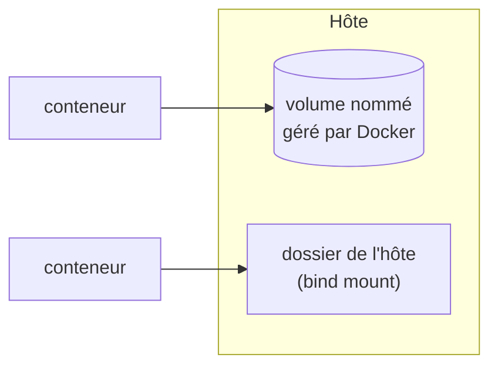
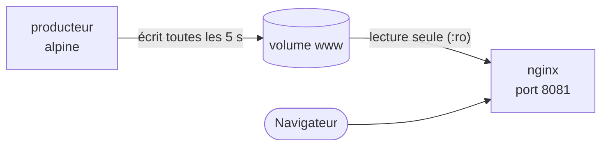

# TP3 — Volumes persistants et partagés

[← TP2](tp2-dockerfile.md) · [Retour à l'accueil](../README.md) · [TP4 →](tp4-reseaux-compose.md)

**Objectif** : conserver des données au-delà de la vie d'un conteneur, partager des fichiers entre conteneurs, injecter une configuration depuis l'hôte, puis sauvegarder et restaurer une base.



| Type | Géré par | Usage typique |
|---|---|---|
| Volume nommé | Docker (`/var/lib/docker/volumes/`) | Données applicatives : bases de données, fichiers produits |
| Bind mount | L'administrateur (un chemin de l'hôte) | Configuration, code en développement |
| tmpfs | La mémoire | Fichiers temporaires, jamais écrits sur disque |

## 1. Persister une base de données

```bash
docker volume create pgdata
docker run -d --name pg1 -e POSTGRES_PASSWORD=Labo2026pwd -v pgdata:/var/lib/postgresql/data postgres:17-alpine
docker exec pg1 psql -U postgres -c "CREATE TABLE t (id serial PRIMARY KEY, msg text);" -c "INSERT INTO t (msg) VALUES ('donnée persistante');"

docker rm -f pg1
docker run -d --name pg2 -e POSTGRES_PASSWORD=Labo2026pwd -v pgdata:/var/lib/postgresql/data postgres:17-alpine
docker exec pg2 psql -U postgres -c "SELECT * FROM t;"
docker volume inspect --format '{{.Mountpoint}}' pgdata
```

**Les données ont survécu à la suppression du conteneur** : le volume a son propre cycle de vie. Sur l'hôte, il est stocké dans `/var/lib/docker/volumes/pgdata/_data`.

Pour attendre que PostgreSQL soit prêt avant de lui parler, une petite fonction teste la connexion en TCP. Pendant son initialisation, l'image `postgres` lance un serveur temporaire qui n'écoute pas sur le réseau : le test ne réussit donc qu'une fois le vrai serveur démarré.

```bash
waitpg() { until docker exec "$1" pg_isready -h 127.0.0.1 -U postgres -q 2>/dev/null; do sleep 1; done; echo "$1 prêt"; }
waitpg pg2
```

## 2. Volume partagé : un producteur, un lecteur



```bash
docker volume create www
docker run -d --name producteur -v www:/out alpine:3.20 \
  sh -c 'while true; do echo "<h1>$(date) - $(hostname)</h1>" > /out/index.html; sleep 5; done'
docker run -d --name web-www -p 8081:80 -v www:/usr/share/nginx/html:ro nginx:1.27-alpine
curl -s http://localhost:8081; sleep 6; curl -s http://localhost:8081
docker exec web-www sh -c 'echo test > /usr/share/nginx/html/test.html'
```

- **La date change toutes les 5 secondes** : les deux conteneurs partagent le même volume. Le nom d'hôte affiché est l'identifiant du conteneur producteur.
- **nginx ne peut pas écrire** (`Read-only file system`) : le montage `:ro` limite le lecteur à la lecture. C'est le principe du moindre privilège appliqué au stockage.

## 3. Injecter une configuration depuis l'hôte

```bash
mkdir -p ~/conf
cat > ~/conf/default.conf <<'EOF'
server {
    listen 80;
    location / {
        default_type text/plain;
        return 200 "config locale\n";
    }
}
EOF
docker run -d --name web-conf -p 8082:80 -v ~/conf:/etc/nginx/conf.d:ro nginx:1.27-alpine
curl -s http://localhost:8082

sed -i 's/config locale/config modifiée/' ~/conf/default.conf
docker exec web-conf nginx -s reload
curl -s http://localhost:8082
```

Après `nginx -s reload`, la nouvelle configuration est appliquée **sans redémarrer le conteneur**.

Le dossier est monté, et non le fichier seul : `sed -i` et la plupart des éditeurs remplacent le fichier par un nouveau (nouvel inode). Un bind mount d'un fichier unique resterait alors attaché à l'ancienne version.

## 4. Sauvegarde et restauration

Deux méthodes, deux usages :

| | Sauvegarde physique (copie du volume) | Sauvegarde logique (`pg_dump`) |
|---|---|---|
| Base arrêtée ? | Oui, pour garantir la cohérence | Non, sauvegarde à chaud |
| Portabilité | Même version majeure de PostgreSQL | Toutes versions, toutes architectures |
| Restauration sélective | Non, tout ou rien | Oui (une base, une table) |
| Taille | Fichiers bruts de la base | Instructions SQL, compressibles |

**Sauvegarde physique** avec un conteneur temporaire qui archive le volume :

```bash
docker stop pg2
docker run --rm -v pgdata:/data:ro -v "$PWD":/backup alpine:3.20 \
  tar czf /backup/pgdata-$(date +%Y%m%d-%H%M%S).tar.gz -C /data .
docker start pg2
```

**Restauration** dans un nouveau volume, puis démarrage d'une base dessus pour vérifier :

```bash
ARCHIVE=$(ls -t pgdata-*.tar.gz | head -1)
docker volume create pgdata-restore
docker run --rm -v pgdata-restore:/data -v "$PWD":/backup:ro alpine:3.20 tar xzf "/backup/$ARCHIVE" -C /data
docker run -d --name pg-restore -e POSTGRES_PASSWORD=Labo2026pwd -v pgdata-restore:/var/lib/postgresql/data postgres:17-alpine
waitpg pg-restore
docker exec pg-restore psql -U postgres -c "SELECT * FROM t;"
```

**Sauvegarde logique** à chaud, puis restauration dans une base de test :

```bash
DUMP=dump-$(date +%Y%m%d-%H%M%S).sql
docker exec pg2 pg_dump -U postgres -d postgres > "$DUMP"
docker exec pg-restore createdb -U postgres testdump
docker exec -i pg-restore psql -U postgres -d testdump < "$DUMP"
docker exec pg-restore psql -U postgres -d testdump -c "SELECT * FROM t;"
```

La sauvegarde logique est celle retenue pour le projet final : elle se fait sans interruption de service ([procédure](../taskboard/README.md#sauvegarder-les-données)).

## À retenir

- Les données d'un service vont **toujours dans un volume**, jamais dans la couche du conteneur.
- `:ro` donne à chaque conteneur **le strict nécessaire**.
- On monte un **dossier** de configuration plutôt qu'un fichier, pour que les modifications soient vues.
- Une sauvegarde n'existe vraiment que **si sa restauration a été testée**.
