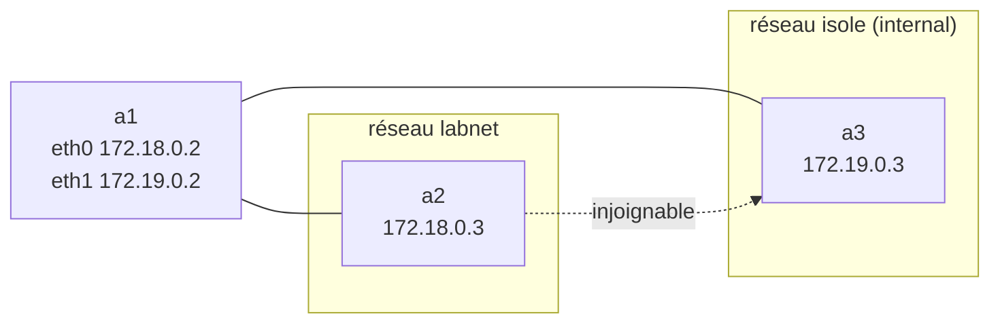
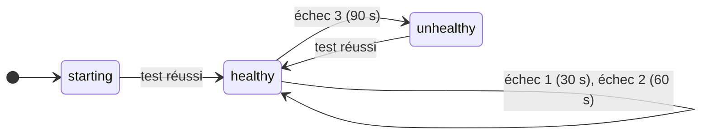

# TP4 — Réseaux et Docker Compose

[← TP3](tp3-volumes.md) · [Retour à l'accueil](../README.md) · [Projet final →](../taskboard/README.md)

**Objectif** : comprendre comment les conteneurs communiquent et s'isolent, puis décrire l'application dans un fichier `compose.yaml` avec des healthchecks qui garantissent l'ordre de démarrage.

Les sorties présentées dans ce document sont celles relevées sur la VM du lab.

## 1. Réseaux à la main

### Bridge par défaut ou réseau personnalisé

```bash
docker run -d --name a1 alpine:3.20 sleep infinity
docker run -d --name a2 alpine:3.20 sleep infinity
docker exec a1 ping -c 2 a2
IP2=$(docker inspect --format '{{range .NetworkSettings.Networks}}{{.IPAddress}}{{end}}' a2)
docker exec a1 ping -c 2 $IP2
```

```text
ping: bad address 'a2'
PING 172.17.0.3 (172.17.0.3): 56 data bytes
64 bytes from 172.17.0.3: seq=0 ttl=64 time=0.075 ms
```

Sur le bridge par défaut (`docker0`), les conteneurs se joignent **par IP mais pas par nom** : il n'y a pas de résolution DNS.

```bash
docker rm -f a1 a2
docker network create labnet
docker run -d --name a1 --network labnet alpine:3.20 sleep infinity
docker run -d --name a2 --network labnet alpine:3.20 sleep infinity
docker exec a1 cat /etc/resolv.conf
docker exec a1 ping -c 2 a2
```

```text
nameserver 127.0.0.11
search localdomain
...
PING a2 (172.18.0.3): 56 data bytes
64 bytes from 172.18.0.3: seq=0 ttl=64 time=0.049 ms
```

Sur un réseau personnalisé, Docker fournit un **DNS interne** (`127.0.0.11`) qui résout le nom des conteneurs.

`nslookup a2` affiche pourtant `NXDOMAIN` pour `a2.localdomain` : le `nslookup` de busybox ajoute le domaine de recherche hérité de la VM et n'affiche que cet essai. Le `ping` prouve que le nom est bien résolu. `nslookup a2.` (avec un point final, nom absolu) donne une réponse propre.

### Réseau interne et conteneur sur deux réseaux

```bash
docker network create --internal isole
docker run --rm --network isole alpine:3.20 wget -qO- -T 5 https://example.com
docker run --rm --network labnet alpine:3.20 wget -qO- -T 5 https://example.com | head -3
```

```text
wget: bad address 'example.com'
<!doctype html><html lang=en><head>...<title>Example Domain</title>...
```

Sur un réseau `--internal`, il n'y a ni passerelle ni NAT, et le DNS interne ne transmet pas les requêtes vers l'extérieur : **le conteneur ne peut même pas résoudre un nom externe**. Sur `labnet`, la même commande récupère la page.



```bash
docker network connect isole a1
docker run -d --name a3 --network isole alpine:3.20 sleep infinity
docker exec a1 ip -4 addr
docker exec a1 ping -c 2 a2
docker exec a1 ping -c 2 a3
docker exec a2 ping -c 2 a3
```

`a1` reçoit une interface par réseau (`eth0` en `172.18.0.2`, `eth1` en `172.19.0.2`) et joint `a2` comme `a3`. `a2` ne joint pas `a3` (`bad address 'a3'`) : **les réseaux restent cloisonnés**, et `a1` ne fait pas passer le trafic de l'un à l'autre. C'est le principe appliqué dans le projet final, où l'API fait le lien entre le front et la base.

## 2. TaskBoard en Compose : base et API

Premier `compose.yaml`, avec la configuration dans un fichier `.env` :

```yaml
services:
  db:
    image: postgres:17-alpine
    env_file: .env
    volumes:
      - db-data:/var/lib/postgresql/data
      - ./db/init.sql:/docker-entrypoint-initdb.d/init.sql:ro
    networks:
      - back

  api:
    build: ./api
    environment:
      DB_HOST: db
      POSTGRES_DB: ${POSTGRES_DB}
      POSTGRES_USER: ${POSTGRES_USER}
      DB_PASSWORD: ${POSTGRES_PASSWORD}
    ports:
      - "5000:5000"
    networks:
      - back

volumes:
  db-data:

networks:
  back:
```

```bash
docker compose up -d --build
docker compose ps
curl -s http://localhost:5000/api/tasks
curl -s -X POST -H 'Content-Type: application/json' -d '{"title":"Rattraper les TP"}' http://localhost:5000/api/tasks
curl -s -X POST -H 'Content-Type: application/json' -d '{}' http://localhost:5000/api/tasks
```

```text
[{"done":false,"id":1,"title":"D\u00e9couvrir Docker Compose"}]
{"done":false,"id":2,"title":"Rattraper les TP"}
{"error":"le champ 'title' est obligatoire"}
```

Compose préfixe les ressources par le nom du projet : `taskboard_db-data`, `taskboard_back`. Le script `init.sql` n'est exécuté qu'à la première initialisation, quand le volume est vide.

### La course au démarrage

```bash
docker compose down -v
docker compose up -d
for i in $(seq 1 15); do curl -s -o /dev/null -w "%{http_code} " http://localhost:5000/api/tasks; sleep 1; done; echo
```

```text
000 200 200 200 200 200 200 200 200 200 200 200 200 200 200
```

Compose lance les conteneurs en parallèle, sans attendre que PostgreSQL soit prêt. Le `000` correspond à la seconde où gunicorn n'écoute pas encore. Sur cette VM, l'initialisation de la base se termine avant la première requête, donc **la course n'a pas provoqué d'erreur visible**. Elle existe pourtant et dépend du hasard : sur une machine plus lente ou avec un script d'initialisation plus lourd, les premières requêtes échoueraient avec une erreur 500. Un `depends_on` simple ne règle rien, car il ordonne le lancement des conteneurs, pas le moment où un service est prêt.

## 3. Healthchecks et ordre de démarrage

```yaml
  db:
    healthcheck:
      test: ["CMD-SHELL", "pg_isready -h 127.0.0.1 -U $${POSTGRES_USER} -d $${POSTGRES_DB}"]
      interval: 5s
      timeout: 3s
      retries: 10
      start_period: 10s

  api:
    depends_on:
      db:
        condition: service_healthy
```

- `$$` empêche Compose de remplacer la variable : c'est le shell du conteneur qui la lit.
- `-h 127.0.0.1` évite un faux positif pendant l'initialisation, car le serveur temporaire n'écoute pas en TCP.

```text
 ✔ Container taskboard-db-1  Healthy     5.7s
 ✔ Container taskboard-api-1 Started     5.8s
```

L'API ne démarre plus qu'une fois la base déclarée saine. Son propre healthcheck, défini dans son Dockerfile au [TP2](tp2-dockerfile.md), la fait passer `(healthy)` à son tour.

### Que se passe-t-il quand la base s'arrête ?

```bash
docker compose stop db
for t in 30 60 90 120; do sleep 30; echo "t=${t}s : $(docker inspect --format '{{.State.Health.Status}} streak={{.State.Health.FailingStreak}}' $(docker compose ps -q api))"; done
curl -i http://localhost:5000/api/health
```

```text
t=30s : healthy streak=1
t=60s : healthy streak=2
t=90s : unhealthy streak=3
t=120s : unhealthy streak=4
HTTP/1.1 503 SERVICE UNAVAILABLE
{"status":"error"}
```



Au bout de 30 secondes, l'API est **encore `healthy`** : un seul test a échoué. Elle passe `unhealthy` après **3 échecs consécutifs** (`retries=3`, un test toutes les 30 s), soit vers 90 secondes, comme le confirme le relevé. `/api/health` renvoie `503` dès l'arrêt de la base. Le conteneur continue de tourner : hors Swarm, Docker ne redémarre pas un conteneur `unhealthy`. L'état sert d'indicateur et de condition de dépendance.

## 4. Vérifications

**Configuration résolue** : `docker compose config` affiche le fichier final, variables remplacées.

```text
      DB_PASSWORD: Tb2026pwd
      ...
      POSTGRES_PASSWORD: Tb2026pwd
```

**Le mot de passe apparaît en clair** (ici un mot de passe de test, propre à ce TP), comme dans `docker inspect`. C'est la limite que le projet final corrige avec un secret Compose.

**Persistance** :

```bash
curl -s -X POST -H 'Content-Type: application/json' -d '{"title":"Tâche persistante"}' http://localhost:5000/api/tasks
docker compose down && docker compose up -d --wait
curl -s http://localhost:5000/api/tasks
docker compose down -v && docker compose up -d --wait
curl -s http://localhost:5000/api/tasks
```

```text
[{"done":false,"id":1,"title":"D\u00e9couvrir Docker Compose"},{"done":false,"id":2,"title":"T\u00e2che persistante"}]
[{"done":false,"id":1,"title":"D\u00e9couvrir Docker Compose"}]
```

`down` supprime les conteneurs et le réseau, **mais conserve le volume** : la tâche est toujours là. `down -v` supprime aussi le volume : la base repart de zéro, avec seulement la tâche d'`init.sql`.

## À retenir

- Toujours des **réseaux personnalisés** : DNS par nom et isolation.
- `internal: true` pour les réseaux qui portent des données.
- `depends_on` seul ne suffit pas : **healthcheck + `condition: service_healthy`**.
- `docker compose config` sert à vérifier, mais montre aussi ce qui fuit (ici, le mot de passe).
- `down` conserve les données, **`down -v` les efface**.
