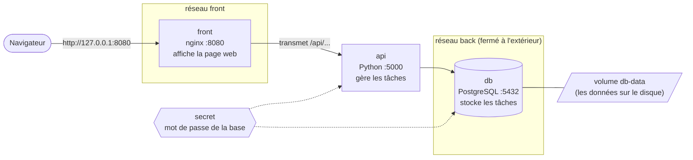
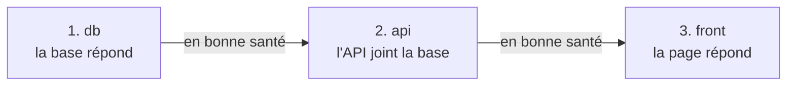

# TaskBoard

TaskBoard est une petite application web de gestion de tâches : on ouvre une page, on écrit une tâche, elle s'ajoute à la liste et reste enregistrée.

Elle fonctionne avec **trois conteneurs Docker** qui travaillent ensemble : un serveur web (nginx), une API en Python et une base de données PostgreSQL. Docker Compose les démarre tous les trois en une seule commande.

Ce document explique, étape par étape, comment installer, vérifier et exploiter l'application. Il est écrit pour être suivi **sans aucune connaissance préalable du projet** : il suffit de copier les commandes dans l'ordre et de comparer avec le résultat attendu.

**Temps nécessaire** : environ 15 minutes, dont la moitié pour télécharger les images la première fois.

## Sommaire

1. [Comment fonctionne l'application](#1-comment-fonctionne-lapplication)
2. [Avant de commencer : comment lire ce document](#2-avant-de-commencer--comment-lire-ce-document)
3. [Prérequis](#3-prérequis)
4. [Installation](#4-installation)
5. [Vérification](#5-vérification)
6. [Ouvrir l'application depuis un autre ordinateur](#6-ouvrir-lapplication-depuis-un-autre-ordinateur)
7. [Exploitation au quotidien](#7-exploitation-au-quotidien)
8. [Sécurité](#8-sécurité)
9. [Dépannage](#9-dépannage)
10. [Variables de configuration](#10-variables-de-configuration)
11. [Tout supprimer et repartir de zéro](#11-tout-supprimer-et-repartir-de-zéro)
12. [Lexique](#12-lexique)

## 1. Comment fonctionne l'application



Le chemin d'une requête :

1. Le **navigateur** ne parle qu'au **front**, sur le port 8080.
2. Le front affiche la page web et transmet les demandes `/api/...` à l'**API**.
3. L'API lit et écrit les tâches dans la **base de données**.
4. La base enregistre tout dans un **volume** : les tâches survivent à l'arrêt et à la suppression des conteneurs.

La sécurité repose sur la séparation : la base est sur un réseau fermé (`back`) que seule l'API peut atteindre. Le front ne voit jamais la base, et la base n'a pas accès à Internet. Un seul port est ouvert, celui du front, et uniquement sur la machine elle-même (`127.0.0.1`).

| Service | Rôle | Réseaux | Port |
|---|---|---|---|
| `front` | Affiche la page web et transmet les appels à l'API | `front` | 8080, ouvert sur `127.0.0.1` |
| `api` | Reçoit les demandes et lit/écrit les tâches | `front` et `back` | 5000, interne |
| `db` | Stocke les tâches | `back` uniquement | 5432, interne |

Les services démarrent toujours dans cet ordre. Chacun attend que le précédent soit **en bonne santé** (vérifié automatiquement par un healthcheck) avant de démarrer :



### Contenu du dossier

```text
taskboard/
├── compose.yaml            # décrit les 3 services, les réseaux, le volume et le secret
├── .env.example            # modèle de configuration (à copier en .env)
├── .gitignore              # fichiers à ne jamais envoyer sur Git (.env, secrets/)
├── README.md               # ce document
├── secrets/
│   └── db_password.txt     # mot de passe de la base, créé à l'installation (jamais sur Git)
├── db/
│   └── init.sql            # crée la table des tâches au premier démarrage
├── api/                    # code et recette de construction de l'API
│   ├── Dockerfile
│   ├── .dockerignore
│   ├── requirements.txt
│   └── app.py
└── front/                  # page web et configuration du serveur nginx
    ├── Dockerfile
    ├── .dockerignore
    ├── nginx.conf
    └── index.html
```

## 2. Avant de commencer : comment lire ce document

- **Où taper les commandes** : sauf mention contraire, toutes les commandes se tapent **dans un terminal du serveur Linux** (connecté en SSH par exemple), **dans le dossier `taskboard`**. Pour vérifier où vous êtes, tapez `pwd` : la réponse doit se terminer par `/taskboard`.
- **Une étape à la fois** : copiez un bloc, collez-le, appuyez sur Entrée, puis comparez avec le « Résultat attendu » avant de passer à la suite.
- **Les exemples tirés du lab** (utilisateur `alt`, serveur `10.31.10.23`) sont signalés comme tels : remplacez-les par vos propres valeurs.
- **Les lignes qui commencent par `#`** dans un bloc sont des explications : le terminal les ignore.
- **`sudo`** exécute une commande avec les droits administrateur. Le terminal peut demander votre mot de passe : il ne s'affiche pas pendant la frappe, c'est normal.
- **⚠️ Action destructive** signale une commande qui efface des données. Lisez l'avertissement avant de la lancer.
- **Le mot « conteneur »** et les autres termes Docker sont expliqués dans le [lexique](#12-lexique) en fin de document.

## 3. Prérequis

Il faut une machine Linux 64 bits (Debian 12/13 ou Ubuntu 22.04+ par exemple) avec un accès Internet et environ 1 Go d'espace disque libre.

Vérifiez chaque élément avec la commande indiquée :

| Élément | Commande de vérification | Résultat attendu |
|---|---|---|
| Docker Engine **25 ou plus** | `docker version --format '{{.Server.Version}}'` | Un numéro ≥ 25, par exemple `29.9.3` |
| Docker Compose v2 | `docker compose version` | `Docker Compose version v2…` ou plus |
| Droit d'utiliser Docker | `docker ps` | Un tableau (même vide), pas `permission denied` |
| Accès au Docker Hub | `docker pull alpine:3.20` | `Status: Downloaded…` ou `Image is up to date…` |
| Git | `git --version` | `git version …` |
| Port 8080 libre | `ss -tln \| grep ':8080 '` | Aucune ligne affichée |

Si un élément manque :

<details>
<summary><b>Installer Docker sur Debian</b> (cliquer pour déplier)</summary>

Procédure officielle Docker. Sur Ubuntu, remplacer `debian` par `ubuntu` dans les deux adresses.

```bash
sudo apt update
sudo apt install -y ca-certificates curl
sudo install -m 0755 -d /etc/apt/keyrings
sudo curl -fsSL https://download.docker.com/linux/debian/gpg -o /etc/apt/keyrings/docker.asc
sudo chmod a+r /etc/apt/keyrings/docker.asc
sudo tee /etc/apt/sources.list.d/docker.sources <<EOF
Types: deb
URIs: https://download.docker.com/linux/debian
Suites: $(. /etc/os-release && echo "$VERSION_CODENAME")
Components: stable
Signed-By: /etc/apt/keyrings/docker.asc
EOF
sudo apt update
sudo apt install -y docker-ce docker-ce-cli containerd.io docker-buildx-plugin docker-compose-plugin
```

Résultat attendu : `docker version` affiche une section `Client` et une section `Server`.

</details>

<details>
<summary><b>Erreur <code>permission denied</code> avec <code>docker ps</code></b></summary>

Votre utilisateur n'a pas le droit d'utiliser Docker. Ajoutez-le au groupe `docker` :

```bash
sudo usermod -aG docker $USER
```

Puis **déconnectez-vous et reconnectez-vous** (fermer la session SSH et la rouvrir) et relancez `docker ps`.

</details>

<details>
<summary><b>Installer Git</b></summary>

```bash
sudo apt install -y git
```

</details>

<details>
<summary><b>Le port 8080 est déjà utilisé</b></summary>

Pas besoin de libérer le port : à l'étape 2 de l'installation, choisissez un autre port avec la variable `FRONT_PORT` (par exemple `8081`) et utilisez-le partout à la place de `8080`.

</details>

## 4. Installation

### Étape 1 : récupérer le projet

Le projet se trouve dans le dossier `taskboard` du dépôt `docker-labs` :

```bash
cd ~
git clone https://github.com/hedjouj/Docker.git docker-labs
cd docker-labs/taskboard
ls -A
```

Résultat attendu : la liste contient `compose.yaml`, `.env.example`, `api`, `db`, `front` et `README.md`.

### Étape 2 : créer le fichier de configuration

```bash
cp .env.example .env
cat .env
```

Résultat attendu : le contenu du fichier s'affiche, avec `POSTGRES_DB=taskboard`, `FRONT_PORT=8080`, etc.

Les valeurs par défaut conviennent dans la plupart des cas. Pour en changer une (par exemple le port), ouvrez le fichier avec `nano .env`, modifiez la valeur, puis enregistrez avec `Ctrl+O`, `Entrée`, et quittez avec `Ctrl+X`. Le détail des variables est dans la section [Variables de configuration](#10-variables-de-configuration).

### Étape 3 : créer le mot de passe de la base

Le mot de passe n'est écrit nulle part dans le projet : on le génère au hasard dans un fichier protégé, le **secret**.

```bash
mkdir -p secrets
chmod 700 secrets
openssl rand -base64 24 > secrets/db_password.txt
chmod 644 secrets/db_password.txt
ls -l secrets/
```

Si la commande `openssl` n'existe pas, remplacez la troisième ligne par :

```bash
head -c 24 /dev/urandom | base64 > secrets/db_password.txt
```

Résultat attendu : une ligne `-rw-r--r-- … db_password.txt`.

À savoir :

- **Ne modifiez pas ce fichier après le premier démarrage** : la base enregistre le mot de passe une seule fois, lors de sa création. Si le fichier change ensuite, l'API ne pourra plus se connecter (voir [Dépannage](#9-dépannage)).
- **Les droits `644` sont nécessaires** : la base et l'API, qui tournent sous des utilisateurs différents, doivent pouvoir lire le fichier. Le dossier en `700` empêche les autres utilisateurs du serveur d'y accéder.

### Étape 4 : vérifier la configuration

```bash
docker compose config --quiet
```

Résultat attendu : **rien ne s'affiche**. Un message d'erreur signale une étape précédente manquée, le plus souvent l'étape 3.

### Étape 5 : construire et démarrer

```bash
docker compose up -d --build --wait
```

Ce que fait cette commande :

- `--build` construit les images de l'API et du front à partir de leur `Dockerfile` ;
- `-d` démarre les conteneurs en arrière-plan ;
- `--wait` attend que les trois services soient en bonne santé avant de rendre la main.

La première fois, Docker télécharge les images de base : comptez 2 à 5 minutes selon la connexion.

Résultat attendu, à la fin :

```text
 ✔ Container taskboard-db-1     Healthy
 ✔ Container taskboard-api-1    Healthy
 ✔ Container taskboard-front-1  Healthy
```

Si la commande échoue ou reste bloquée plus de 2 minutes après le téléchargement, appuyez sur `Ctrl+C` et passez à la section [Dépannage](#9-dépannage).

**L'installation est terminée.** Passez à la vérification.

## 5. Vérification

### 5.1 Les trois services sont en bonne santé

```bash
docker compose ps --format 'table {{.Name}}\t{{.Status}}\t{{.Ports}}'
```

Résultat attendu : les trois lignes indiquent `(healthy)`, et **seul le front** a un port ouvert, sur `127.0.0.1` :

```text
NAME                STATUS                    PORTS
taskboard-api-1     Up 30 seconds (healthy)   5000/tcp
taskboard-db-1      Up 36 seconds (healthy)   5432/tcp
taskboard-front-1   Up 25 seconds (healthy)   127.0.0.1:8080->8080/tcp
```

`(health: starting)` signifie que le service démarre encore : attendez quelques secondes et relancez la commande.

### 5.2 L'application répond

Une commande à la fois :

```bash
curl -s http://127.0.0.1:8080/healthz
```

Résultat attendu : `ok` (le front fonctionne).

```bash
curl -s http://127.0.0.1:8080/api/health
```

Résultat attendu : `{"host":"…","status":"ok"}`, où `…` est une suite de chiffres et de lettres (l'identifiant du conteneur de l'API). L'API fonctionne et joint la base.

```bash
curl -s http://127.0.0.1:8080/api/tasks
```

Résultat attendu : la tâche créée à l'installation.

```text
[{"done":false,"id":1,"title":"Découvrir Docker Compose"}]
```

`é` est la façon dont le format JSON écrit la lettre `é` : c'est normal.

```bash
curl -s -X POST -H 'Content-Type: application/json' -d '{"title":"Ma première tâche"}' http://127.0.0.1:8080/api/tasks
```

Résultat attendu : `{"done":false,"id":2,"title":"Ma première tâche"}`. La tâche est enregistrée.

### 5.3 Les données sont conservées

On supprime les conteneurs, on les recrée, et on vérifie que la tâche est toujours là :

```bash
docker compose down
docker compose up -d --wait
curl -s http://127.0.0.1:8080/api/tasks
```

Résultat attendu : la liste contient toujours « Ma première tâche ». `docker compose down` supprime les conteneurs, mais pas le volume où sont stockées les données.

### 5.4 La sécurité est en place

Chaque commande teste une protection :

```bash
docker compose exec front wget -q -O- -T 3 http://db:5432
```

Résultat attendu : `wget: bad address 'db:5432'`. Le front ne peut pas joindre la base.

```bash
docker compose exec db wget -q -O- -T 3 https://example.com
```

Résultat attendu : `wget: bad address 'example.com'`. La base n'a pas accès à Internet.

```bash
docker compose exec api env | grep -i pass
```

Résultat attendu : une seule ligne, `DB_PASSWORD_FILE=/run/secrets/db_password`. Le mot de passe n'est pas dans les variables, seulement le chemin du fichier secret.

```bash
docker compose exec api id
docker compose exec front id
```

Résultat attendu : `uid=10001(appuser)` pour l'API et `uid=101(nginx)` pour le front. Aucun des deux ne tourne en administrateur (`root`).

```bash
sudo ss -tlnp | grep 8080
```

Résultat attendu : une ligne contenant `127.0.0.1:8080`. Le port n'est ouvert que sur la machine elle-même.

## 6. Ouvrir l'application depuis un autre ordinateur

Pour des raisons de sécurité, la page n'est accessible que depuis le serveur lui-même (`127.0.0.1`). Pour l'ouvrir dans le navigateur de votre ordinateur, on crée un **tunnel SSH** : il fait passer la connexion de votre ordinateur vers le serveur de façon chiffrée.

Sur **votre ordinateur** (Windows : ouvrir **PowerShell** ; macOS ou Linux : ouvrir un **Terminal**), tapez :

```bash
ssh -L 8080:127.0.0.1:8080 alt@10.31.10.23
```

Dans cet exemple tiré du lab, `alt` est l'utilisateur du serveur et `10.31.10.23` son adresse IP : remplacez-les par les vôtres. L'adresse IP du serveur s'obtient avec `hostname -I` sur le serveur. Saisissez votre mot de passe quand il est demandé.

Puis, **sans fermer cette fenêtre**, ouvrez dans votre navigateur :

```text
http://localhost:8080
```

Résultat attendu : la page **TaskBoard** s'affiche. Écrivez une tâche, cliquez sur **Ajouter** : elle apparaît dans la liste.

Le tunnel se ferme quand vous fermez la fenêtre SSH.

## 7. Exploitation au quotidien

Toutes ces commandes se lancent dans le dossier `taskboard` du serveur.

### Consulter l'état et les journaux

```bash
# État des services
docker compose ps
# Journaux de l'API en direct (Ctrl+C pour quitter)
docker compose logs -f api
# 100 dernières lignes des 10 dernières minutes, tous services
docker compose logs --since 10m --tail 100
# Utilisation CPU et mémoire
docker stats --no-stream
```

Les journaux tournent automatiquement : 3 fichiers de 10 Mo au maximum par conteneur, le disque ne se remplit donc pas.

### Arrêter et redémarrer

```bash
# Arrêter sans rien supprimer
docker compose stop
# Redémarrer après un stop
docker compose start
# Redémarrer un seul service
docker compose restart api
# Supprimer les conteneurs (les données sont conservées)
docker compose down
# Recréer et démarrer après un down
docker compose up -d --wait
```

> ⚠️ **Action destructive** : `docker compose down -v` supprime aussi le volume, donc **toutes les tâches, définitivement**. Faites une [sauvegarde](#sauvegarder-les-données) avant.

Si le serveur redémarre, l'application redémarre toute seule (politique `restart: unless-stopped`), sauf si elle avait été arrêtée volontairement avec `docker compose stop`.

### Sauvegarder les données

```bash
mkdir -p backups
docker compose exec -T db sh -c 'pg_dump -U "$POSTGRES_USER" -d "$POSTGRES_DB" --clean --if-exists' \
  | gzip > backups/taskboard-$(date +%Y%m%d-%H%M%S).sql.gz
ls -lh backups/
```

Résultat attendu : un fichier nommé avec la date et l'heure de la sauvegarde, par exemple `taskboard-20261117-160000.sql.gz`, de quelques Ko. La sauvegarde se fait sans arrêter l'application.

Copiez régulièrement le dossier `backups/` sur une autre machine : une sauvegarde restée sur le même serveur disparaît avec lui.

Pour une sauvegarde automatique chaque nuit à 2 h, ouvrez la planification avec `crontab -e` et ajoutez la ligne suivante. Elle suppose que le projet est installé dans `~/docker-labs/taskboard`, comme à l'[étape 1](#étape-1--récupérer-le-projet). Les `%` doivent rester précédés d'un `\` :

```text
0 2 * * * cd "$HOME/docker-labs/taskboard" && docker compose exec -T db sh -c 'pg_dump -U "$POSTGRES_USER" -d "$POSTGRES_DB" --clean --if-exists' | gzip > backups/taskboard-$(date +\%Y\%m\%d).sql.gz
```

### Restaurer une sauvegarde

> ⚠️ **Action destructive** : la restauration remplace **tout** le contenu actuel de la base par celui de la sauvegarde.

La commande suivante sélectionne automatiquement la sauvegarde la plus récente, l'affiche, puis la restaure :

```bash
SAUVEGARDE=$(ls -t backups/taskboard-*.sql.gz | head -1)
echo "Restauration de : $SAUVEGARDE"
gunzip -c "$SAUVEGARDE" \
  | docker compose exec -T db sh -c 'psql -q -U "$POSTGRES_USER" -d "$POSTGRES_DB" -v ON_ERROR_STOP=1'
curl -s http://127.0.0.1:8080/api/tasks
```

Pour restaurer une sauvegarde plus ancienne, listez-les avec `ls -lt backups/` et indiquez son nom à la place de la première ligne, par exemple `SAUVEGARDE=backups/taskboard-20261117-160000.sql.gz`.

Résultat attendu : la liste des tâches est revenue à l'état du moment de la sauvegarde.

### Mettre à jour l'application

```bash
# 1. Récupérer la nouvelle version du code
git pull
# 2. Indiquer le nouveau numéro de version (ici 1.1.0)
sed -i 's/^TASKBOARD_VERSION=.*/TASKBOARD_VERSION=1.1.0/' .env
# 3. Reconstruire et redémarrer
docker compose up -d --build --wait
docker compose ps
```

Seuls les services modifiés sont recréés, et les données sont conservées.

**Revenir à la version précédente** en cas de problème (possible tant que l'ancienne image existe encore, voir `docker images 'taskboard-*'`) :

```bash
sed -i 's/^TASKBOARD_VERSION=.*/TASKBOARD_VERSION=1.0.0/' .env
docker compose up -d --wait
```

### Augmenter le nombre d'API (scaling)

L'API ne garde aucune donnée en mémoire : on peut en lancer plusieurs copies pour répartir la charge. Le front les découvre par le DNS interne de Docker, qu'il interroge toutes les 10 secondes, puis leur envoie les requêtes à tour de rôle.

```bash
docker compose up -d --scale api=3 --wait
docker compose ps api
sleep 10
for i in $(seq 1 6); do curl -s http://127.0.0.1:8080/api/health; echo; done
```

Le `sleep 10` laisse au front le temps de découvrir les nouvelles copies.

Résultat attendu : trois conteneurs `taskboard-api-1`, `-2` et `-3`, et trois valeurs `host` différentes qui reviennent à tour de rôle : ce sont les trois copies qui répondent chacune leur tour.

Pour revenir à une seule copie :

```bash
docker compose up -d --scale api=1 --wait
```

## 8. Sécurité

| Protection | Comment elle est appliquée |
|---|---|
| Séparation des réseaux | La base est sur un réseau fermé (`internal`) que seule l'API atteint |
| Exposition minimale | Un seul port ouvert (le front), uniquement sur `127.0.0.1` |
| Mot de passe protégé | Secret Compose, monté en fichier dans `/run/secrets/` ; absent du `compose.yaml`, des variables d'environnement et de `docker inspect` |
| Pas d'administrateur | L'API tourne sous l'utilisateur 10001, le front sous l'utilisateur 101 (`nginx`) |
| Fichiers en lecture seule | `read_only: true` sur l'API et le front ; seul `/tmp`, en mémoire, est modifiable |
| Privilèges réduits | `cap_drop: [ALL]` sur l'API et le front, `no-new-privileges` sur les trois services |
| Ressources limitées | API : 0,5 CPU et 256 Mo de mémoire ; front : 0,25 CPU et 64 Mo |
| Images maîtrisées | Versions précises, images de base minimales (`slim`, `alpine`), aucun secret dans les images |
| Dépôt propre | `.env` et `secrets/` exclus de Git par `.gitignore` ; un `.dockerignore` par image |

Pour rechercher les vulnérabilités connues dans les images, avec l'outil Trivy lancé dans un conteneur :

```bash
for img in taskboard-api:1.0.0 taskboard-front:1.0.0 postgres:17-alpine; do
  docker run --rm -v /var/run/docker.sock:/var/run/docker.sock -v trivy-cache:/root/.cache/ \
    aquasec/trivy:0.69.3 image --scanners vuln --severity HIGH,CRITICAL "$img"
done
```

Résultat attendu : pour chaque image, un tableau des vulnérabilités importantes (`HIGH`) et critiques (`CRITICAL`), avec une ligne `Total: …`.

## 9. Dépannage

Commencez toujours par ces deux commandes : elles indiquent quel service pose problème et pourquoi.

```bash
docker compose ps -a
docker compose logs --tail 50
```

| Ce que vous voyez | Cause probable | Solution |
|---|---|---|
| `docker compose up` affiche une erreur sur `secrets/db_password.txt` | Le mot de passe n'a pas été créé | Refaire l'[étape 3](#étape-3--créer-le-mot-de-passe-de-la-base), puis `docker compose up -d --wait` |
| `permission denied` en lançant une commande `docker` | L'utilisateur n'a pas le droit d'utiliser Docker | Voir [Prérequis](#3-prérequis), « Erreur permission denied » |
| `db` redémarre en boucle, avec `Permission denied` dans `docker compose logs db` | Le fichier du mot de passe n'est pas lisible | `chmod 644 secrets/db_password.txt` puis `docker compose up -d --wait` |
| `api` reste `unhealthy`, avec `password authentication failed` dans `docker compose logs api` | Le fichier du mot de passe a été modifié après le premier démarrage | Remettre l'ancien fichier s'il a été conservé. Sinon, voir la procédure sous ce tableau |
| `port is already allocated` | Le port 8080 est déjà utilisé sur le serveur | Mettre un autre port dans `FRONT_PORT` (fichier `.env`), puis `docker compose up -d --wait` |
| La page affiche `502 Bad Gateway` | L'API est arrêtée ou en erreur | `docker compose ps`, puis `docker compose logs api` |
| La page ne s'ouvre pas depuis votre ordinateur | Normal : le port n'est ouvert que sur le serveur | Utiliser le [tunnel SSH](#6-ouvrir-lapplication-depuis-un-autre-ordinateur) |
| La table des tâches n'existe pas, ou une modification de `db/init.sql` n'a aucun effet | Ce script ne s'exécute qu'au tout premier démarrage, quand la base est vide | ⚠️ Effacer et recréer la base : `docker compose down -v` puis `docker compose up -d --wait` (perte des données ; sauvegarder avant) |
| `unknown flag: start-interval` pendant la construction | Docker est trop ancien (version inférieure à 25) | Mettre Docker à jour (voir [Prérequis](#3-prérequis)) |
| Une modification du code n'apparaît pas | L'image n'a pas été reconstruite | `docker compose up -d --build --wait` |
| `docker pull` ou la construction échoue avec une erreur réseau | Pas d'accès au Docker Hub (proxy, pare-feu) | Vérifier l'accès avec `curl -sI https://registry-1.docker.io/v2/` : toute réponse `HTTP/…`, même `401`, prouve que le Docker Hub est joignable |

**Remettre le mot de passe de la base en accord avec le fichier secret.** On se connecte à la base sans mot de passe depuis l'intérieur de son conteneur, puis on définit le nouveau mot de passe :

```bash
cat secrets/db_password.txt
docker compose exec db sh -c 'psql -U "$POSTGRES_USER" -d "$POSTGRES_DB"'
```

Dans l'invite `taskboard=#` qui s'ouvre, tapez `\password`, collez deux fois le contenu affiché par `cat`, puis tapez `\q` pour quitter. Ensuite :

```bash
docker compose restart api
docker compose ps
```

Autres commandes utiles pour comprendre un problème :

```bash
# Historique des tests de santé de l'API
docker inspect --format '{{json .State.Health}}' taskboard-api-1
# L'API trouve-t-elle la base ?
docker compose exec api python -c "import socket; print(socket.gethostbyname('db'))"
# Configuration complète, telle que Docker la comprend
docker compose config
```

## 10. Variables de configuration

Ces variables se règlent dans le fichier `.env`, créé à l'[étape 2](#étape-2--créer-le-fichier-de-configuration). Après une modification, appliquez-la avec `docker compose up -d --wait`.

| Variable | Valeur par défaut | À quoi elle sert |
|---|---|---|
| `POSTGRES_DB` | `taskboard` | Nom de la base de données, créée au premier démarrage |
| `POSTGRES_USER` | `taskboard` | Utilisateur de la base de données |
| `FRONT_PORT` | `8080` | Port de la page web sur le serveur (ouvert sur `127.0.0.1` uniquement) |
| `TASKBOARD_VERSION` | `1.0.0` | Numéro de version des images construites, utile pour revenir en arrière |

`POSTGRES_DB` et `POSTGRES_USER` ne sont pris en compte qu'à la création de la base : pour les changer ensuite, il faut repartir d'une base vide.

Le mot de passe n'est **pas** dans `.env` : il est dans un fichier à part.

| Fichier | Où il apparaît dans les conteneurs | Rôle |
|---|---|---|
| `secrets/db_password.txt` | `/run/secrets/db_password` (services `db` et `api`) | Mot de passe de la base, généré à l'installation, jamais envoyé sur Git |

Variables fixées dans `compose.yaml`, **à ne pas modifier** :

| Variable | Service | Valeur | Rôle |
|---|---|---|---|
| `POSTGRES_PASSWORD_FILE` | `db` | `/run/secrets/db_password` | Indique à PostgreSQL où lire le mot de passe |
| `DB_HOST` | `api` | `db` | Nom sous lequel l'API trouve la base |
| `DB_PASSWORD_FILE` | `api` | `/run/secrets/db_password` | Indique à l'API où lire le mot de passe |

## 11. Tout supprimer et repartir de zéro

> ⚠️ **Action destructive** : efface l'application, ses images et **toutes les tâches**. Faites une sauvegarde avant si besoin.

```bash
docker compose down -v --rmi all
cd ~
rm -rf docker-labs
```

Résultat attendu : `docker compose ls` n'affiche plus `taskboard`. Pour réinstaller, reprenez à l'[étape 1](#étape-1--récupérer-le-projet).

## 12. Lexique

| Terme | Explication simple |
|---|---|
| **Image** | Modèle figé d'une application, avec tout ce dont elle a besoin pour fonctionner. On la construit à partir d'un `Dockerfile` |
| **Conteneur** | Une application en cours d'exécution, lancée à partir d'une image et isolée du reste du serveur |
| **Docker Compose** | Outil qui démarre plusieurs conteneurs ensemble à partir d'un fichier de description (`compose.yaml`) |
| **Service** | Un des composants décrits dans `compose.yaml` : ici `front`, `api` et `db` |
| **Volume** | Espace de stockage géré par Docker, qui conserve les données même quand les conteneurs sont supprimés |
| **Réseau** | Réseau privé entre conteneurs. Seuls les conteneurs d'un même réseau peuvent se parler, en s'appelant par leur nom |
| **Secret** | Fichier contenant une information sensible (ici le mot de passe), donné aux seuls conteneurs qui en ont besoin |
| **Healthcheck** | Test automatique qui vérifie régulièrement qu'un service fonctionne : `healthy` (en bonne santé) ou `unhealthy` (en panne) |
| **Port** | Numéro de « porte » par laquelle on joint un service, par exemple 8080 pour la page web |
| **`127.0.0.1`** | Adresse qui désigne la machine elle-même : un service qui n'écoute que là n'est pas joignable depuis le réseau |
| **Tunnel SSH** | Connexion chiffrée qui permet d'atteindre depuis son ordinateur un service réservé au serveur |
